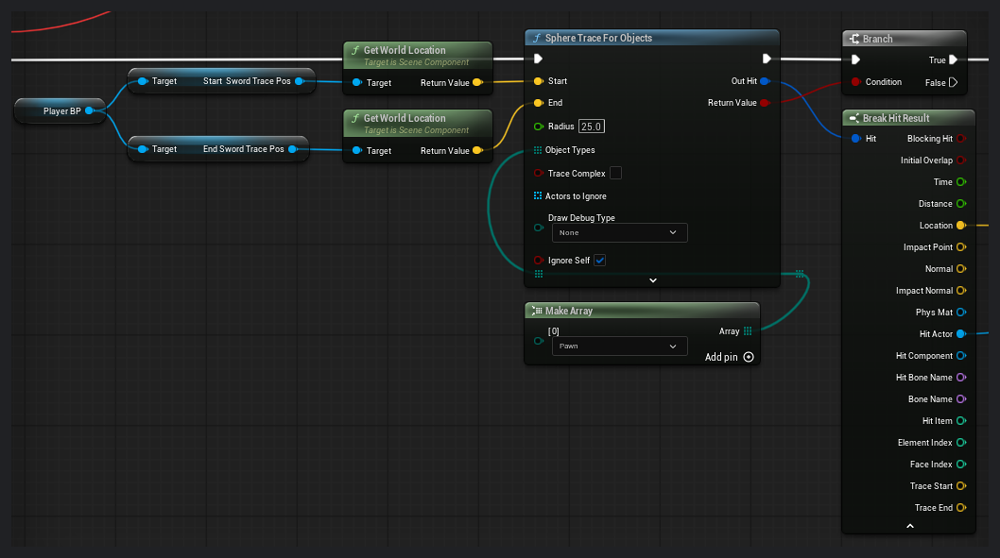
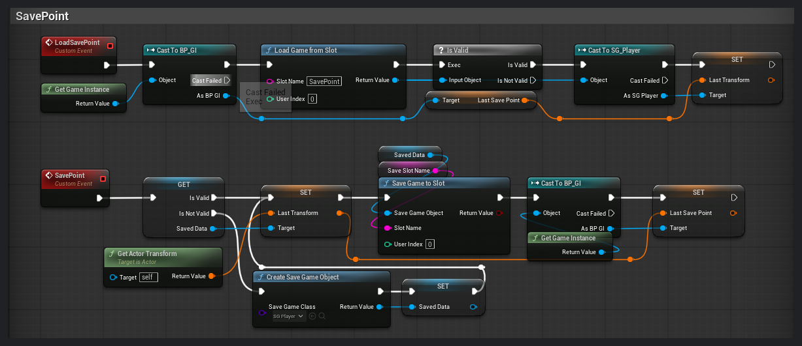

# DAWN

적의 공격 타이밍을 읽고 회피와 방어로 빈틈을 만드는 **PC 소울라이크 액션 게임**입니다. 첫 팀 프로젝트에서 게임플레이를 Unreal Engine 블루프린트로 구현하고, 다섯 명의 디자이너가 제작한 작업물을 하나의 플레이 흐름으로 통합했습니다.

[프로젝트 홈페이지](https://kdw1102.imweb.me/DAWN) · [플레이 영상: 튜토리얼부터 보스전까지](https://youtu.be/ywilBaU21Kw) · [게임 빌드 다운로드](https://naver.me/FQuvLIed)

## 프로젝트와 담당 역할

| 항목 | 내용 |
| --- | --- |
| 제작 기간 | 2025.03 ~ 2025.07 |
| 환경 | PC · Unreal Engine 5.4 · Blueprint |
| 팀 구성 | 6명: 배경 디자인 2명, 캐릭터 디자인 2명, UI·VFX 디자인 1명, 프로그래밍 1명 |
| 김동우 · 게임플레이 | 플레이어 전투·조작, 몬스터·보스 AI, 아이템·성장·저장, HUD·게임 진행 UI 기능 구현 |
| 김동우 · 프로젝트 통합 | 팀원별 파일·에셋 병합, 엔진 프로젝트 설정 관리와 통합 오류 대응 |

## 대표 블루프린트

### 1. 검이 닿은 대상을 판정하고 피해를 전달하기

검에 설정한 시작점과 끝점의 월드 좌표 사이에서 반경 25의 `Sphere Trace For Objects`로 Pawn을 검사합니다. 자기 자신은 검사 대상에서 제외하고, 충돌이 검출되면 Hit Result에서 대상과 충돌 위치를 꺼냅니다.

[후속 그래프](blueprints/01-combat/Trace2.png)에서는 `Do Once`를 거쳐 검의 공격력을 `Apply Damage`에 전달하고 충돌 위치에서 타격음과 이펙트를 재생합니다. [피격 측 그래프](blueprints/01-combat/Damage1.png)는 방어·회피 여부와 스태미나에 따라 후속 처리를 나눕니다.

### 2. 재시작 후에도 체크포인트 위치 이어가기

`SavePoint` 이벤트는 저장 객체를 확인하고, 없으면 새로 생성합니다. 캐릭터의 Transform을 저장 객체에 기록해 슬롯에 쓰고 GameInstance의 마지막 체크포인트도 갱신합니다. 위쪽의 `LoadSavePoint` 흐름에서는 슬롯에서 읽은 객체가 유효한지 검사합니다.

[재시작 호출 순서](blueprints/06-save/Save1.png)에서는 데이터와 체크포인트를 저장한 뒤 로딩 위젯을 표시하고 레벨을 재시작합니다.

## 테마별 그래프 모음

| 테마 | 확인할 동작 | 개별 캡처 |
| --- | --- | --- |
| [전투 판정](blueprints/01-combat/) | 검 트레이스와 피해 적용, 방어·회피 상태에 따른 피격 분기 | [Trace1](blueprints/01-combat/Trace1.png) · [Trace2](blueprints/01-combat/Trace2.png) · [Damage1](blueprints/01-combat/Damage1.png) · [Damage2](blueprints/01-combat/Damage2.png) |
| [방향 회피](blueprints/02-dodge/) | 입력 방향 기록과 방향별 회피 몽타주 선택 | [Dodge2](blueprints/02-dodge/Dodge2.png) · [Dodge1](blueprints/02-dodge/Dodge1.png) |
| [타깃 락온](blueprints/03-lock-on/) | 카메라 기준 위치·방향 계산, 대상 표시 부착, 타깃을 향한 시점 회전 | [Lockon1](blueprints/03-lock-on/Lockon1.png) · [Lockon2](blueprints/03-lock-on/Lockon2.png) · [Lockon3](blueprints/03-lock-on/Lockon3.png) |
| [성장·드롭](blueprints/04-growth-and-loot/) | 몬스터 처치 보상과 포션 생성 확률, 경험치에 따른 레벨·능력치 갱신 | [MonsterDrop](blueprints/04-growth-and-loot/MonsterDrop.png) · [Levelup](blueprints/04-growth-and-loot/Levelup.png) |
| [상호작용·튜토리얼](blueprints/05-interaction/) | 범위 내 상호작용 대상 등록·해제와 튜토리얼 위젯 표시 | [Interact](blueprints/05-interaction/Interact.png) · [Tutorial](blueprints/05-interaction/Tutorial.png) |
| [체크포인트 저장](blueprints/06-save/) | 저장·로딩·재시작 순서와 체크포인트 위치 저장·불러오기 | [Save1](blueprints/06-save/Save1.png) · [Save2](blueprints/06-save/Save2.png) |

## 첫 팀 프로젝트에서 배운 점

전투를 구현하는 일과 팀원들의 애니메이션·이펙트·UI를 게임에 연결하는 일은 서로 다른 작업이었습니다. 파트별 전달 기준을 맞추고 통합 오류를 수정하는 데 예상보다 많은 시간이 들어, 이후에는 핵심 기능을 작은 단위로 나눠 수시로 통합하고 오류 수정 시간도 일정에 포함하고자 했습니다. 이 경험을 바탕으로 개인 프로젝트 [망각의 성채](https://github.com/Gdongu/Citadel-of-Oblivion)에서는 전투와 진행 시스템을 C++ 중심으로 다시 구현했습니다.

이 저장소는 블루프린트 캡처를 열람하는 포트폴리오입니다. 실행은 상단의 게임 빌드를 이용해 주세요. 팀 개발 당시의 [Git·LFS 환경 설정 메모](docs/git-lfs-setup.md)도 별도로 보관했습니다.
